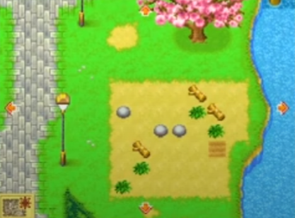
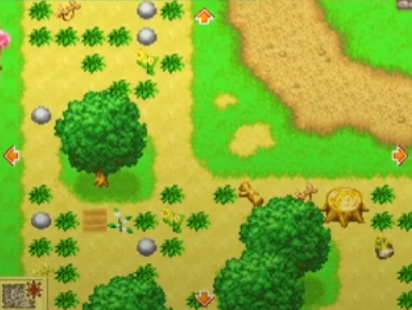
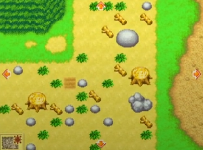

<!-- paginate: true -->

# コロボックルステーション Earth% 資料

---

## 作品概要

発売日：2005/3/17
機　種：ニンテンドーDS

舞台は「わすれ谷」(ワンダフルライフの舞台)
シリーズ初のDS作品で、タッチパネルを使った操作が特徴です。

やりこみ要素を含めると牧場物語でもトップレベルでやれることが多いです。(全作物・果樹、動物がレベル100まで上がります。)

---

## ストーリー

### 概要

女神様と魔女様が喧嘩して女神様が別世界に飛ばされてしまった。
コロボックルが抗議したらコロボックルも飛ばされてしまった。
その場に居合わせた主人公が女神様とコロボックルを救出することになった。

---

## カテゴリについて

### カテゴリ概要

コロボックルを20体救出したときに解放される、
コロボックルの「てるす」(英語名：Earth)を解放するまでのRTA

### タイマー基準

- スタート
  - 「初めから」を押した瞬間
- ストップ
  - てるすが解放された瞬間

---

## チャート解説 (1/5)

1. チュートリアル
2. 4/8まで寝る
3. 町長を追い返してから池を調べる(**カラフ**)
4. じょうろで池の水を10回汲む(**ミスティ**)
5. 色付きの草を食べながら宿の焼却炉を調べる(**テップ**)
   - この時に白い花を4個以上確保しておく
6. 色付きの草を食べながらお屋敷の噴水を調べる(**ジャン**)

---

## チャート解説 (2/5)

7. 井戸を調べる(**ホップス**)
8. 宿入り口で10時を待つ
   - 待機時間にシークレットマスに水やり(**ミジーロ**)
9. 宿入り口で10時を待つ
   - 待機時間にシークレットマスに水やり(**エヴィラン**)
10. 宿入り口で10時を待つ
    - 待機時間にシークレットマスに水やり(**オウ**)
11. バーンの箱の上(**テンジン**)

---

## チャート解説 (3/5)

12. バーンに白い花を売り、所持金を1000G以上にする
13. バーンからチカラデールを99個購入し、売る
    - 【Quick purchase】
14. 家に帰って、雑貨屋に電話しカゴとリュックを購入
    - 【Missed connections】
15. にわとりりあに電話し、にわとりのえさを99*11こ購入
    - 【Missed connections】
16. 購入したエサを全部出荷する(**フラウ**)

---

## チャート解説 (4/5)

17. 馬を取得する
18. 馬に出荷する(**カモナス**)
19. 馬に乗って農場エリアに移動し、わすれ谷から出ようとする(**テンシュウ**)
20. 遺跡エリアで色付きの草を食べる(**アニメ**)
21. 牧場に帰り、カゴをもってコロボックルの家に行く

---

## チャート解説 (5/5)

22. コロボックルの家でレコードを5個購入(**ゆぴてる**)
23. コロボックルの家でカゴにアイテムを入れた瞬間に家を出る(**ベジタール**)
24. 農場エリアへの橋を渡る(**ダブリン**)
    - 【Veggie buffer / Roller skip】
25. バーで適当な飲み物を1杯飲む(**スピリー**)
26. てるすが解放されGG

---

## 乱数調整について

DS本体の日時設定を2000年1月1日 0:00にしてゲームを開始することで、シークレットマスのコロボックルの位置を固定する。
シークレットマスの位置はセーブ・ロードでも変わるし、1度ずれるとリカバリが困難となる。

---

## シークレットマス

### 日本版

- 牧場の下
- ゴーディの家の上
- サーカスのとこの横

### 海外版

- 元シートに記載なし

---

## 主要グリッチ① Quick purchase

### 解説

- Earth%の重要なglitchの1つ。やり方も簡単な上に応用が効く
- 所持金以上のアイテムを購入できる
- 購入直後、カーソル位置は初期値として売値1Gの『オノ』を指している。カーソル位置のアイテムが反映される前にAボタンを押すと、所持金の判定が1Gのオノに対して行われる

### やり方

1. 買いたい商品を1個購入し、商品購入後のセリフから商品選択画面に戻った瞬間に再度Aボタンを押す
2. 上画面で選択中の商品の説明が出るが、これが**オノ**になっていれば成功

---

## 主要グリッチ② Missed connections

### 解説

- 本来なら営業時間外・定休日の店に電話をかけて買い物ができる
- 最短でイベントを起こそうとすると必須
- 電話の可否は、カーソルが合っている店に対して判定される。判定後にタッチでカーソルを別の店へずらすと、ずらした先の店に、ずらす前の判定結果のまま電話をかけられる

### やり方

1. 電話をかけてつながる店舗に電話をかける
2. 1.とほぼ同時に、本来用があるところをタッチパネルで選択する

---

## 主要グリッチ③ Veggie buffer

### 解説

- このカテゴリでしか使用しないが、時間短縮には非常に効果的
- かごにアイテムを投入し、ベジタール(英名：veggie)が救出されるまでに画面を切り替える
- 次にそのエリアを訪れるまで、ベジタールの救出イベントが発生しなくなる

### やり方

1. かごにアイテムを投入した瞬間にエリア移動をする

---

## 主要グリッチ④ Roller skip

### 解説

- Veggie bufferをコロボックルの家で発生させた状態で、農場エリアへの橋を渡りダブリンの救出イベントを発生させる
- カジノエリアの説明をベジタールの救出イベントで上書きできる
- **副作用でカジノには一生入れなくなる**

### やり方

1. Veggie buffer発動中に、農場エリアへの橋を春の8日以降にうまに乗らずに渡る

